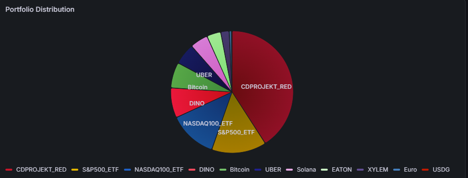

# Personal Investment Tracker

An automated, real-time investment portfolio monitoring system. It combines live cryptocurrency data from the Kraken exchange with manually entered assets (e.g., stocks/ETFs from XTB) and visualizes them on an interactive dashboard.


*(Note: Ensure your screenshot is named Portfolio_chart.png and placed in the root directory)*

## Key Features
* **Kraken API Integration:** Automatically fetches cryptocurrency balances and converts them to USD based on live market prices.
* **Manual Assets Support:** Loads stock and ETF holdings seamlessly from a local JSON file (e.g., for XTB or other platforms).
* **Time-Series Database:** Stores historical data reliably using InfluxDB.
* **Grafana Visualization:** A clean, interactive pie chart displaying the portfolio's percentage and monetary value breakdown.
* **Dockerized:** Fully containerized environment for easy, consistent, and reproducible deployments.

## Technologies Built With
* **Python 3** (Requests, InfluxDB-client)
* **InfluxDB**
* **Grafana**
* **Docker & Docker Compose**

## How to Run Locally

### 1. Clone the repository
```bash
git clone [https://github.com/makshala43-maker/Investment-Tracker-with-Kraken-and-XTB.git](https://github.com/makshala43-maker/Investment-Tracker-with-Kraken-and-XTB.git)
cd Investment-Tracker-with-Kraken-and-XTB
```

### 2. Environment Setup
Create a `.env` file in the root directory and add your Kraken API credentials:
```env
KRAKEN_API_KEY=your_api_key_here
KRAKEN_API_SECRET=your_api_secret_here
```

### 3. Asset Configuration
Create a `manual_assets.json` file in the root directory (refer to `manual_assets.json.example` for the structure):
```json
{
  "XTB_Stocks": [
    {"name": "CDPROJEKT", "value_usd": 550.0},
    {"name": "DINO", "value_usd": 300.0},
    {"name": "S&P500_ETF", "value_usd": 1200.0}
  ]
}
```

### 4. Start the Containers
```bash
docker-compose up -d --build
```

### 5. Access the Dashboard
* **Grafana:** http://localhost:3000 (Default credentials: admin / admin)
* **InfluxDB:** http://localhost:8086

## Disclaimer
This project is for educational and hobbyist purposes only. It does not constitute financial or investment advice.
